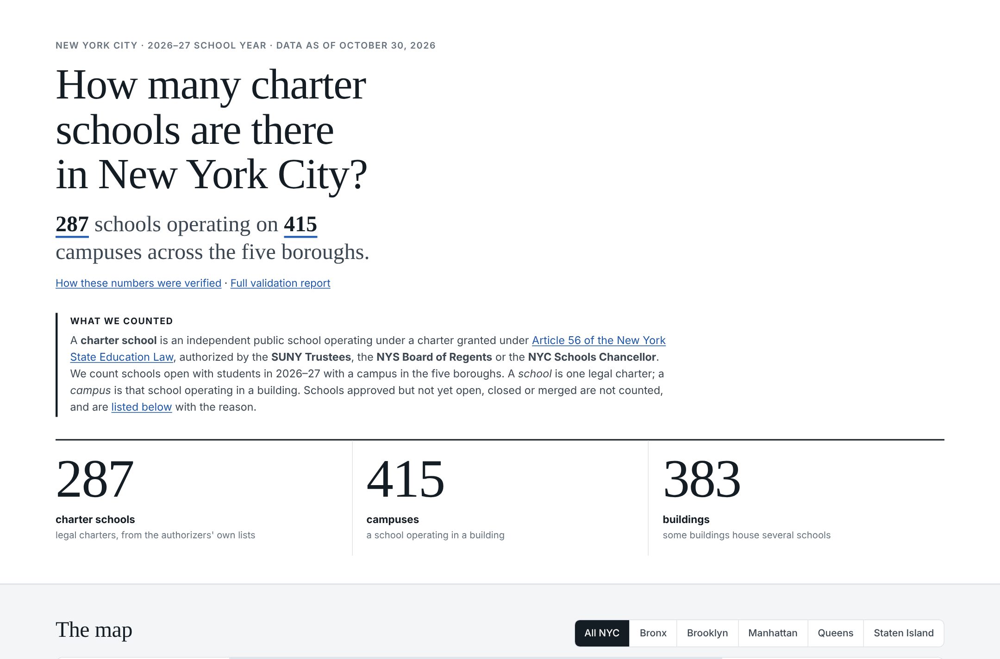
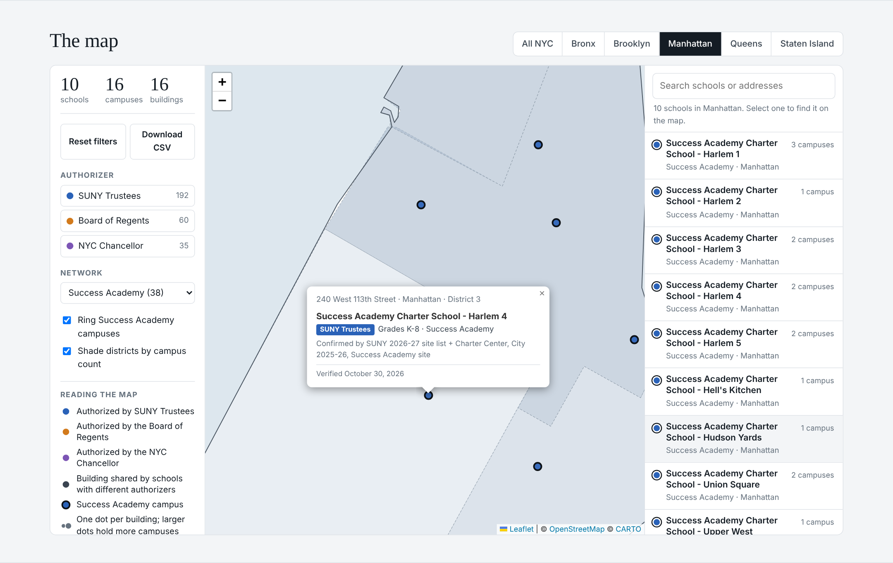

# NYC Charter Schools Map, 2026–27

A map of every charter school operating in New York City on October 30, 2026: **287 schools on 415 campuses** across the five boroughs, each campus confirmed by at least two independent sources.

**Live map:** [tdavidson820.github.io/nyc-charter-schools-ma](https://tdavidson820.github.io/nyc-charter-schools-ma/)
**How every number was checked:** [VALIDATION.md](VALIDATION.md)

## What it shows

The page opens with the definition it uses, because the answer to "how many charter schools are there" depends entirely on it. A charter school here is an independent public school operating under a charter granted under Article 56 of the New York State Education Law, authorized by the SUNY Trustees, the Board of Regents or the NYC Chancellor, open with students in 2026–27, with a campus in the five boroughs. A *school* is a legal charter and a *campus* is that school operating in a building, so the page reports both.

Right under the headline numbers sits the map, with one marker per building, colored by authorizer and with Success Academy campuses ringed. Buttons fly to each borough; filters cover authorizer and operator network; districts are shaded by campus count with the ranges shown in the legend. A searchable list of schools beside the map finds any school on it, and every marker can also be reached from the keyboard. Each popup lists every school in the building, its grades, network and the sources that confirm it is there. The counts of schools, campuses and buildings update as you filter, Reset filters returns to the full city, and Export CSV downloads exactly the campuses on screen.

Below the map are the breakdown charts (campuses by borough, schools by authorizer, the largest networks), the key findings, the verification steps, and every school on a state list that is *not* counted, with the reason (not yet open, closed, merged, consolidated, transferred, renamed), along with every directory listing that turned out to be an old address.





## Approach

The most damaging outcome for a map like this is a confident number that is wrong, so accuracy came before design.

1. **Decide which schools exist, from the authorizers.** The school list comes from SUNY's 2026–27 list, the Regents roster adjusted for every Regents action since, and the state directory for Chancellor schools. Nothing comes from an AI model's memory, which can easily be out of date.
2. **Place each school's campuses, with two independent sources each.** The authorizer's site list, the NYC Charter School Center's finder, the city's 2025–26 transportation site list, school websites, and dated 2026 documents. Matching required the same school at the same building, not just the same address, because many buildings are shared.
3. **Research every conflict individually.** Eighteen items needed it. Each was settled by the school's own website, an authorizer document, or dated news.
4. **Reconcile the totals.** Every one of the Charter Center finder's 420 listings is accounted for, one by one.
5. **Blind audit.** A random sample was rechecked by an independent pass that never saw this dataset.

The cross checks caught real errors in every source, including the authorizer's own list. SUNY's list omits an operating school and shows a school at the building it left in September. The Charter Center finder has test records and old addresses. A city record places a Brooklyn school 84 km away, and the city's own geocoder returned the wrong building three times. All of this is documented in [VALIDATION.md](VALIDATION.md).

## How AI was used

I built this with Claude (Anthropic) as a research and engineering partner, and the way we worked is the part I would most want a reviewer to see.

**I set the standard and made the calls.** Before any data was pulled, I defined what counts as a charter school, what "as of today" means, the difference between a school and a campus, which sources are authoritative, and that every difference from a published figure had to be explained. Claude asked me those questions as multiple choice so the decisions were explicit and recorded.

**Claude did the legwork at a scale I could not by hand.** It captured six sources, wrote the matching and reconciliation scripts, geocoded every address, and researched each conflict against school websites, Regents documents and news coverage, citing what it found.

**Nothing was trusted without a check.** Every captured source was checksummed at the source and after transfer. Every coordinate was compared across sources. Every count was reconciled against an outside figure. Every exclusion has a written reason. The final sample was audited by a separate agent with no access to our data. The checks also overturned one of our own earlier decisions: a school we had excluded because it was missing from SUNY's list turned out to be renewed through 2029 and fully operating, and it was added back.

**Judgment calls are visible, not hidden.** Where sources disagree, the choice and the reason are written into the data (`note` and `evidence` columns) and into the validation report.

## Repository

```
index.html, styles.css, app.js     the page (Leaflet, no build step)
data/campuses.csv                  415 verified campuses with evidence for each
data/legal_schools.csv             287 schools and their authorizer
data/legal_schools_excluded.csv    every school on a state list that is not counted, and why
data/buildings.geojson, summary.json   generated files the page reads
data/sources/                      the raw source captures, unchanged
data/review/                       coordinate checks, count reconciliation, blind audit sample and results
docs/                              screenshots
scripts/                           the pipeline, one script per step
```

## Run it

```bash
pip install -r requirements.txt
python scripts/legal_schools.py && python scripts/build_campuses.py
python scripts/reconcile_counts.py && python scripts/build_site_data.py
python scripts/check_data.py        # 19 data integrity checks
python -m http.server 8000          # then open http://localhost:8000
```

The GitHub Action in `.github/workflows` runs the data integrity checks on every push and publishes to GitHub Pages only if they all pass. It does not refresh the data automatically, on purpose: a refresh means recapturing the sources and repeating the review, and that review is what makes the numbers trustworthy.

## What I would add next

Enrollment and seats by campus, to show capacity rather than just locations. A layer comparing charter availability with student need by district. And a scheduled job that recaptures the sources and flags anything that changed for human review, rather than publishing changes silently.
